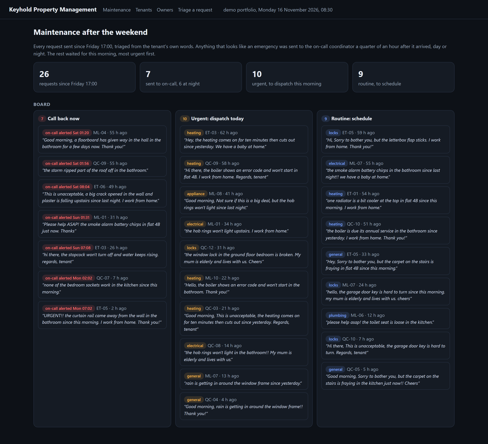
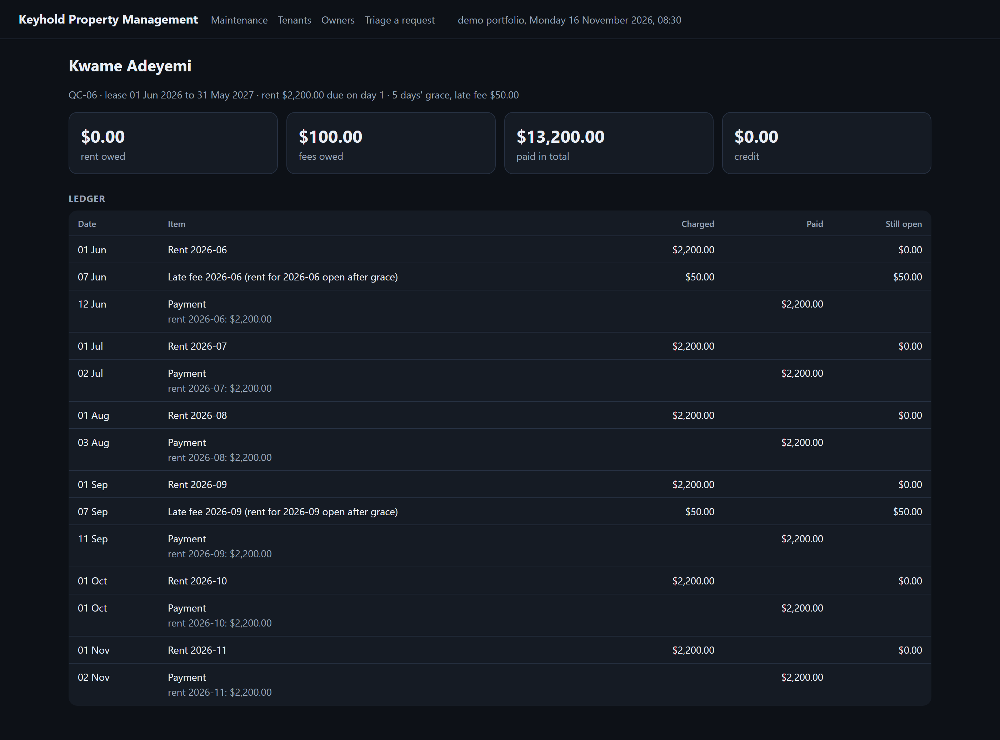
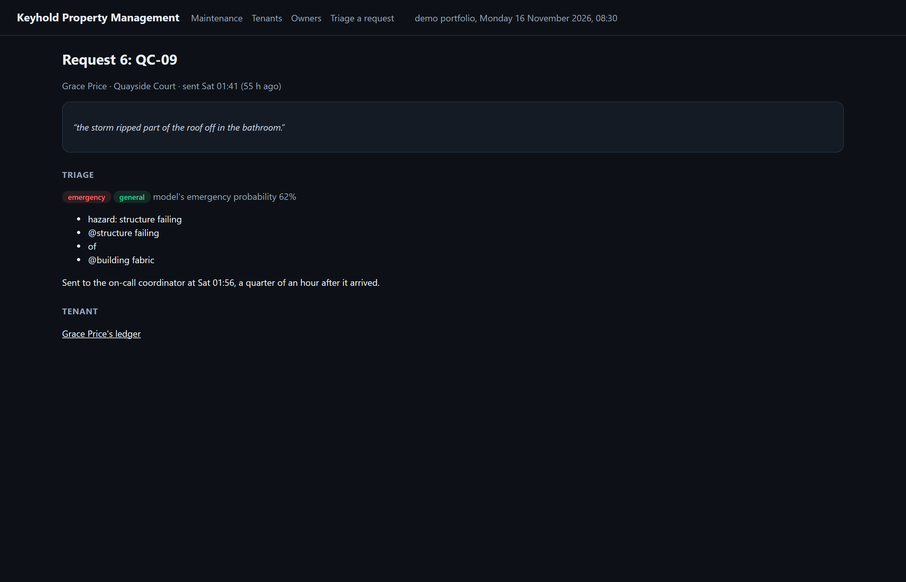

# Property Management SaaS

[](https://github.com/codeROCK-IZZY/property-management-saas/actions/workflows/ci.yml)


Property management software built around two places where small mistakes hurt tenants:

- **Maintenance emergencies that wait for Monday.** Tenants report problems in their own words, at any hour. A burst
  pipe or a smell of gas must not wait behind a squeaky door until the office opens. Every request is triaged from
  its text (urgency and trade), and anything that looks like an emergency goes to the on-call coordinator within a
  quarter of an hour, day or night.
- **Late fees that pile up on tenants who paid.** The rent ledger prorates part months, charges a late fee once per
  month after the grace period, and applies payments to rent before fees, so one late month never turns into a fee
  every month.

It also has owner statements (rent collected, less the management fee and maintenance), and an optional second
reading by Claude that can raise a request's urgency but never lower it.



## Results

`propman evaluate --gate` trains the triage on one set of phrasings, then tests it on wording it has never seen.
The **fresh phrasings** were written after the classifier and the evaluation were committed (freeze `74fa0c6`).
These are the results on them:

| Messages (1,500) | Emergencies caught | False alarms | Urgency right | Trade right |
|---|---:|---:|---:|---:|
| Keyword rules ("gas", "flood", "urgent"...) | 14.8% | 8.6% | 61.0% | 67.3% |
| Learned model, words only | 84.4% | 30.5% | 64.8% | 52.7% |
| **Triage: hazard screen + learned model** | **90.4%** | 19.3% | 71.5% | 77.2% |

The same triage in simulated months of 8 portfolios (3,235 requests, 311 emergencies). The office reads the inbox
three times each weekday; requests flagged as emergencies get an on-call call-back; some tenants phone in anyway:

| Who decides what's urgent | Emergencies attended within 4 hours | Median | Longest wait | False alarms a week (at night) |
|---|---:|---:|---:|---:|
| Inbox order, no triage | 160 of 311 (51%) | 3.7 h | 62 h | 0 |
| Keyword rules flag emergencies | 184 of 311 (59%) | 3.2 h | 62 h | 8.3 (1.3) |
| **Triage flags emergencies** | **301 of 311 (97%)** | 2.2 h | 23 h | 17.6 (3.1) |

A year of rent for 1,000 simulated tenants, with the same payments run through two ledgers:

| How payments are applied | Late fees | Fees charged while all rent was paid | Paid all rent, but shown owing rent |
|---|---:|---:|---:|
| Strictly oldest first | 3,395 | 1,756 | 286 of 904 |
| **Rent before fees (this ledger)** | **1,639** | **0** | **0 of 904** |

What the numbers show:

- **Keywords follow the tenant's tone, not the problem.** "URGENT!!" on a dripping tap is flagged; "the ceiling is
  bulging and dripping fast" is not. Keyword rules caught 15% of emergencies written in fresh words.
- **A model trained on words learns sentences, not dangers.** The first version was perfect on messages that reused
  its training phrasings and caught 30% of emergencies on new ones. Testing on held-out *phrasings*, not just
  held-out messages, is what showed this.
- **A hazard lexicon carries across wordings.** "Smoking", "scorched", "burning" and "hot to touch" all mean heat
  where it shouldn't be. With the lexicon as both a screen and model features, triage caught 90% of emergencies in
  fresh words, and 97% of emergencies were attended within 4 hours instead of 51%.
- **The price is false alarms.** About one in five non-emergencies gets an on-call call-back: 17.6 a week per
  portfolio, 3.1 of them at night. **That missed the limit of 3.0 a week set before the test.** It was reported, not
  tuned away (see [ADR 1](docs/adr/0001-hazard-screen-plus-model.md)).
- **The misses have no hazard words.** "The ceiling has come down", "the socket went bang and is black", "the window
  frame fell out": the report lists every miss.
- **Allocation order matters as much as the fee itself.** Applying payments strictly oldest first doubled the fees
  and showed 286 tenants who had paid all their rent as owing rent ([ADR 2](docs/adr/0002-payments-to-rent-before-fees.md)).

These are synthetic messages written by one person (see [known limitations](docs/known-limitations.md)); read them as
a test of the method, not a forecast for a real portfolio.



## How it works

```
tenant's message ─► hazard screen (water, fire, gas, power, security, structure, cold) ─┐
                 └► logistic regressions on words, word pairs and hazard concepts ──────┴► urgency, trade, reasons
emergency ─► on-call call-back within 15 min, day or night      urgent / routine ─► inbox, most urgent first
optional: Claude reads it too (strict tool, quote required) ─► may raise urgency, never lower it
lease + payments ─► monthly rent (prorated), late fee once after grace, payments to rent before fees ─► balances
owner + month ─► rent collected − management fee − maintenance ─► statement and payout
```

- **Triage** (`triage.py`). The lexicon names the dangers; the model learns how they combine and decides urgent or
  routine and the trade. Settings come from cross-validation that holds out whole phrasings, and the emergency
  threshold is the lowest one within a false-alarm budget. See [ADR 1](docs/adr/0001-hazard-screen-plus-model.md).
- **Dispatch simulation** (`dispatch.py`). Requests arrive through the day and night; the inbox is read at 9:00,
  13:00 and 16:00 on weekdays; flagged requests get a call-back that finds the truth.
- **Ledger** (`ledger.py`). Whole cents, proration by days let, one late fee per month, rent before fees, credit
  carried forward. See [ADR 2](docs/adr/0002-payments-to-rent-before-fees.md).
- **Claude** (`reader.py`). `claude-opus-5-5`, low effort, refusal fallbacks, a strict tool with a required quote.
  Not measured here. See [ADR 3](docs/adr/0003-claude-raises-never-lowers.md).



Decisions: [docs/adr](docs/adr). Gaps: [docs/known-limitations.md](docs/known-limitations.md).

## Run it

```bash
python -m venv .venv && . .venv/bin/activate
pip install -e ".[dev]"

propman triage "Sorry to bother you, but the fuse box is smoking"
propman board                           # the demo portfolio's requests since Friday
propman serve                           # the console on http://127.0.0.1:8000
propman evaluate --gate                 # eval/reports/report.{md,json,html}
pytest
```

API: `POST /api/triage {"text"}`, `GET /api/requests` and `GET /api/tenants`.

## Tests and CI

- **Core:** the corpus split by phrasing, with no fresh phrasing reused; tone independent of the label; the lexicon
  reading different words for the same danger, and ignoring safety equipment; triage reasons; keyword rules
  following tone; the false-alarm budget; inbox checks skipping nights and weekends; on-call routing and false-alarm
  counting; proration; one late fee per month after grace; rent before fees; oldest-first pyramiding; credit; owner
  statements; a ledger year with no pyramided fees.
- **Services:** Claude's reading **through the real Anthropic SDK** with canned responses (the request shape, raising
  urgency with a quote, never lowering it, unquoted or unknown answers ignored, a refusal keeping the local triage),
  the console's pages and API, and the CLI.
- **CI:** ruff, `mypy --strict`, tests on Python 3.12 and 3.13, the evaluation gate, the container serving the
  console, and a gitleaks scan of the full history.

## License

MIT
